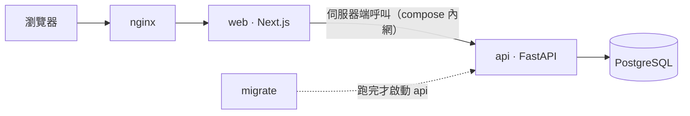

# Share Wallet

一群人一起記帳的網頁 App。家人共用的生活費、室友的共同基金、朋友出遊的分帳，
都放在同一個地方，每個人用自己的手機記、隨時看得到餘額和誰欠誰。

以手機為主設計，可以加到主畫面當 App 用。

## 解決什麼問題

- **共用的錢沒有人說得清楚還剩多少**：誰領了、誰付了、誰先墊了，散落在各自的記帳 App 或群組訊息裡。
- **出遊分帳算到頭痛**：每筆付款人不同、分攤的人也不同，回來還要有人整理 Excel 算誰該給誰多少。
- **帳被改了沒人知道**：共用的帳最怕「我記得不是這個數字」，需要留下誰在什麼時候改了什麼。

## 兩種錢包

| | 一般錢包 | 旅遊錢包 |
|---|---|---|
| 適合 | 家用、個人帳戶、共同存款 | 一趟旅程 |
| 看的是 | **餘額**：這個錢包現在有多少錢 | **分帳**：每個人應收、應付多少 |
| 記什麼 | 收入、支出、錢包間轉帳、替人代墊與還款、調整餘額 | 誰付了多少、哪些人分攤（均分或指定金額） |
| 怎麼結束 | 持續使用 | 結算 → 大家照方案付款、收款人確認 → 自動封存 |

兩種錢包彼此獨立：出遊的花費在旅遊錢包算清楚，結帳只是紀錄，不會寫回任何一般錢包。

## 怎麼用

1. **註冊、建立錢包**：建立的人就是管理者。
2. **用連結邀請大家**：管理者產生邀請連結丟到群組，點開的人登入或註冊後就加入（一天內有效）。
3. **各自記帳**：每個成員都能記帳，改刪自己記的；管理者可以改刪任何人的帳。
4. **隨時查帳**：每筆帳的新增、修改、刪除都有異動紀錄，所有成員都看得到。
5. **旅遊結束時結算**：系統依每個人的淨額算出最少筆數的付款方案，付完、收款人確認，錢包就封存。

錢包裡的事由錢包自己的管理者決定，不需要網站管理員開權限；網站管理員在後台只負責救援
（例如管理者都不在了），不介入日常記帳。

## 開發

需要 Docker Desktop、`make`、`openssl`、`uv` 與 Node（版本見 [`apps/web/.nvmrc`](apps/web/.nvmrc)）。

```bash
make init dev   # 產生 .env（MODE=development，金鑰自動產生）並安裝相依
make start      # 啟動開發環境（首次建置約 2–5 分鐘）
```

### 技術

| | |
|---|---|
| 後端 | FastAPI、SQLAlchemy 2.0 async、Alembic、Python 3.14；pytest、ruff、mypy |
| 前端 | Next.js 16、React 19、TypeScript、CSS Modules；Vitest、ESLint、knip |
| 基礎設施 | PostgreSQL 17、Docker Compose（dev／prod）、nginx、GitHub Actions |
| 平台功能 | JWT 認證、公開註冊、角色權限、使用者與角色管理、Session 撤銷、登入限流、游標分頁 |
| 前後端契約 | 後端產生 OpenAPI → 前端型別，端點、權限、語系寫錯都是編譯錯誤 |
| i18n | 前後端一致的中英雙語，漏翻譯會編譯失敗 |

### 架構

```text
app（組裝層） → modules（垂直功能） → shared（平台能力）
```

- **每個功能是一個模組**，前後端同名，各自擁有路由、資料表、權限、畫面與測試。
- **跨模組只走 public entry**，由 import-linter（後端）與 dependency-cruiser（前端）強制執行。
- **測試與原始碼同構**：`tests/modules/users/` 對 `modules/users/`。



瀏覽器只認得 nginx，碰不到 api。

### 文件

| | |
|---|---|
| [`AGENTS.md`](AGENTS.md) | 給 AI agent 的規則與陷阱 |
| [`docs/architecture.md`](docs/architecture.md) | 依賴規則、模組介面、目錄結構、前後端契約 |
| [`docs/development.md`](docs/development.md) | 指令、測試策略、程式碼風格、CI |
| [`docs/features/`](docs/features/README.md) | 產品規則，一個主題一份：錢包、成員、記帳、結算，以及帳號、角色、Session、限流、語系 |
| [`docs/extending.md`](docs/extending.md) | 擴充項目：新增模組、權限、migration、語系 |
| [`docs/operations.md`](docs/operations.md) | 部署、主機設定、備份與救援 |
| [`docs/decisions/`](docs/decisions/README.md) | 設計決策（ADR）：刻意不採用主流做法的地方與理由 |
